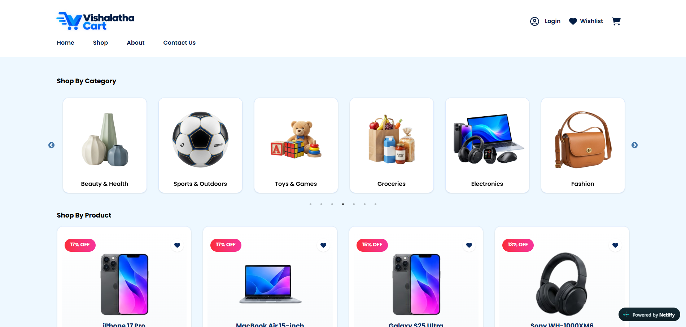
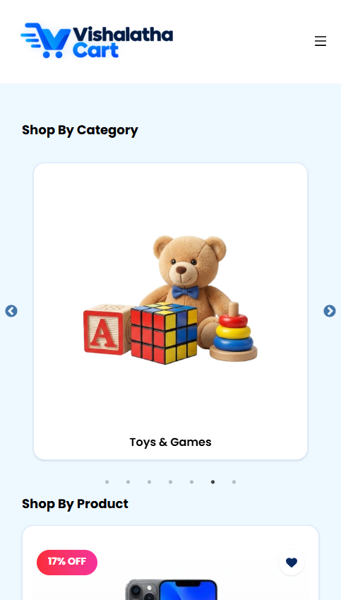
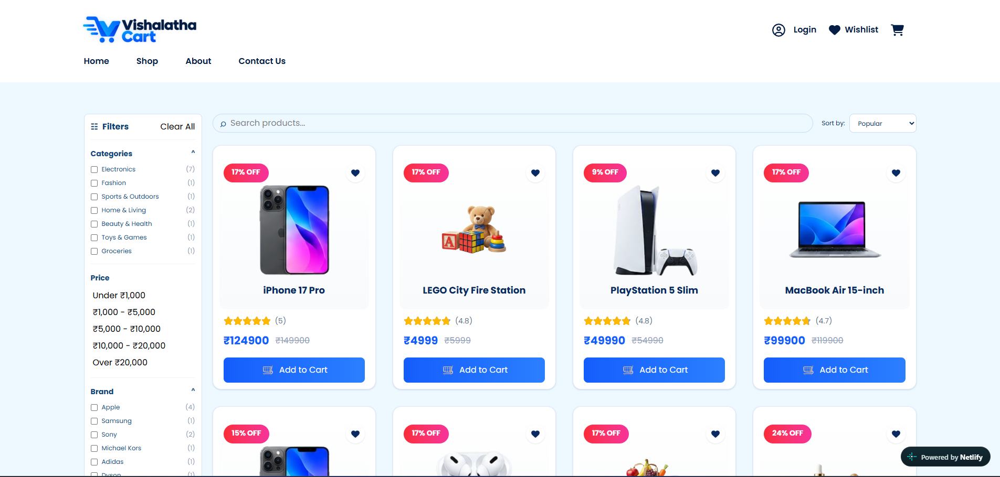
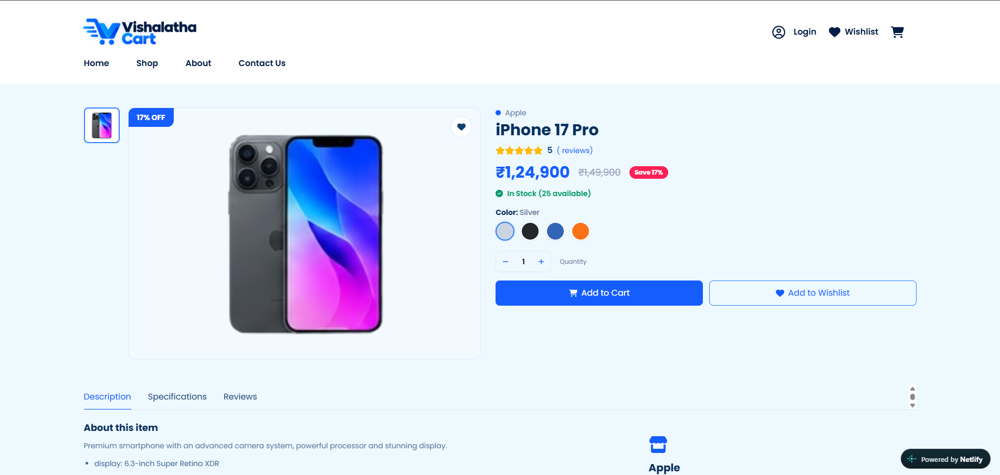
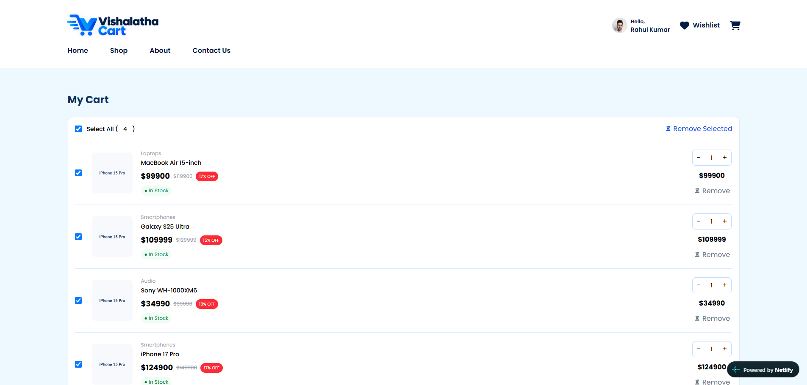
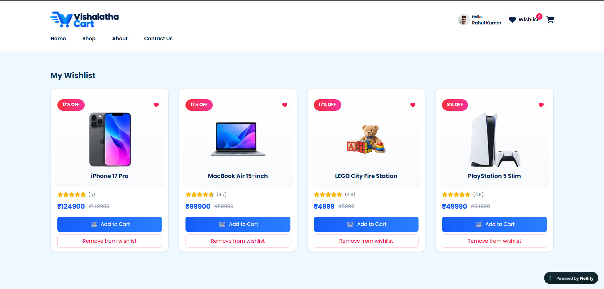
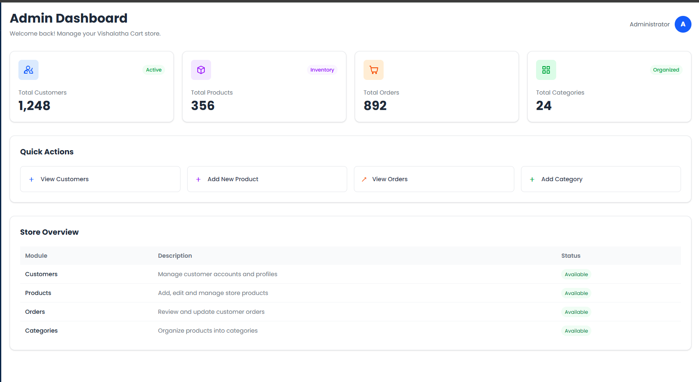
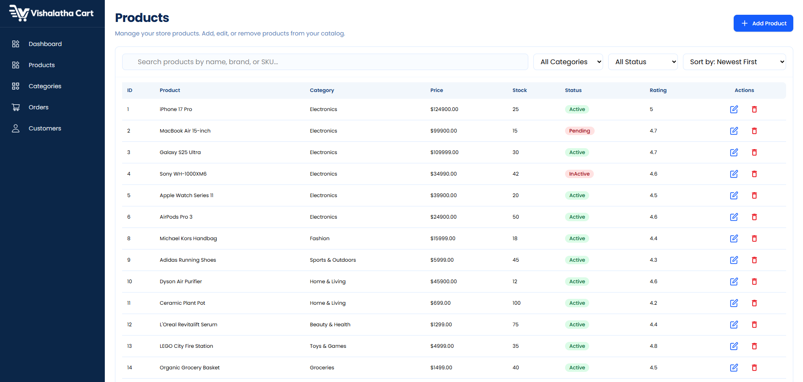
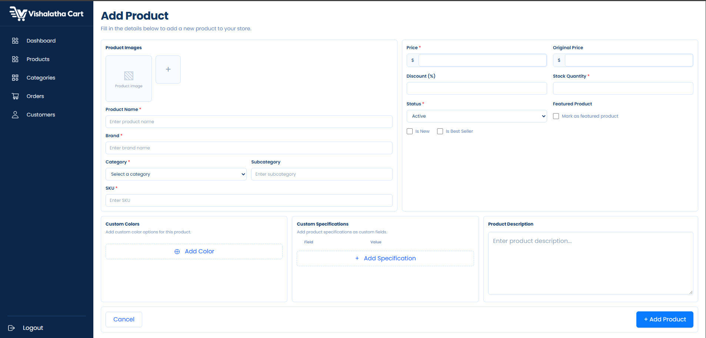

# Vishalatha Cart 🛍️

## 🌐 Live Demo

[Visit Vishalatha Cart](https://vishalathacart.netlify.app/)

## 📌 Description

**Vishalatha Cart** is a responsive e-commerce web application designed to provide users with a simple and convenient online shopping experience. Customers can explore products, browse categories, manage their wishlist, and add products to their shopping cart. The application also includes an admin interface for managing products, categories, orders, and customer information.

## ✨ Features

- **Product Listing:** Display products with images, names, prices, discounts, ratings, and availability.
- **Product Categories:** Organize products into categories such as Electronics and Fashion.
- **Product Details:** Display product information, specifications, available colors, storage options, and pricing.
- **Shopping Cart:** Add products to the cart and manage selected items.
- **Wishlist:** Save favorite products for future purchases.
- **User Authentication:** Support login functionality for customers and administrators.
- **Admin Dashboard:** Provide an overview of customers, products, orders, and categories.
- **Product Management:** Allow administrators to add, edit, and delete products.
- **Category Management:** Manage product categories and their status.
- **Order Management:** Provide an interface for viewing and managing customer orders.
- **Customer Management:** View and manage registered customer information.
- **Role-Based Access:** Restrict administrative functionality to users with the admin role.
- **Responsive Design:** Adapt the interface to mobile phones, tablets, and desktop screens.
- **Modern UI:** Use a clean, consistent interface for browsing and managing products.

## 🎯 Project Goals

The main goal of this project is to develop a functional and user-friendly e-commerce application while improving practical frontend development skills.

Through this project, I aim to:

- Learn how to build reusable UI components using React.
- Develop responsive layouts using Tailwind CSS.
- Understand state management for shopping cart and wishlist functionality.
- Implement form validation and user authentication workflows.
- Organize product, category, customer, and order data.
- Learn role-based access control for customer and admin interfaces.
- Practice project structuring, debugging, and deployment.
- Gain hands-on experience deploying a web application using Netlify.

## 🛠️ Technologies Used

- **Frontend:** React.js
- **Styling:** Tailwind CSS
- **Programming Language:** JavaScript (ES6+)
- **Routing:** React Router DOM (if configured)
- **State Management:** React Hooks, including `useState` and `useEffect`
- **Icons:** Lucide React / React Icons (depending on the installed package)
- **Image Handling:** HTML file inputs, image previews, and JavaScript FileReader APIs where required
- **Version Control:** Git and GitHub
- **Deployment:** Netlify

*Note: Update the technology list to match the packages and tools actually used in your project.*

## 🤖 AI Integration (Optional)

AI-powered features are not currently documented as part of this project.

If AI functionality is added in the future, this section can describe the AI tools or APIs used, their benefits to customers, and the implementation challenges.

## 🚀 Setup Instructions

### Prerequisites

Make sure you have the following installed:

- Node.js (preferably a current LTS version)
- npm
- Git
- A code editor such as Visual Studio Code

### Installation Steps

**1. Clone the repository**


```bash
git clone https://github.com/devrathul/VishalathaCart.git
```

**2. Navigate to the project directory**

```bash
cd vishalatha-cart
```

**3. Install dependencies**

```bash
npm install
```

**4. Start the development server**

For a typical React project created using Vite:

```bash
npm run dev
```

For a project created using Create React App, use:

```bash
npm start
```

Use the command supported by your project's `package.json`.

**5. Open the application**

Open the local URL displayed in your terminal. For Vite, the default is usually:

```text
http://localhost:5173
```

For Create React App, the default is usually:

```text
http://localhost:3000
```

## 📱 Responsive Design

Vishalatha Cart is designed to provide a consistent shopping experience across different screen sizes.

- **Mobile:** 375px and above
- **Tablet:** 768px and above
- **Desktop:** 1024px and above

The responsive layout helps users navigate product listings, view product details, manage their cart, and access account features on different devices.

## 📸 Screenshots


Suggested screenshots:

1. Home page


2. Product listing and product details


3. Wishlist and shopping cart


4. Admin dashboard

5. Admin product management page



## 🎨 Design Choices

- **Clean Interface:** Keep the layout simple and easy to navigate.
- **Consistent Branding:** Use a consistent color palette, typography, buttons, and spacing throughout the application.
- **Product-Focused Layout:** Give product images, prices, discounts, and important details clear visual priority.
- **Reusable Components:** Structure the interface into reusable components to improve maintainability.
- **Responsive Layout:** Use Tailwind CSS utilities to adapt the layout to different screen sizes.
- **Separate Admin Interface:** Provide administrators with dedicated pages for managing store information.
- **Role-Based Permissions:** Separate customer shopping functionality from administrative operations.

## ⚠️ Known Issues and Limitations

The following items should be verified against the current implementation:

- Product, customer, and order data persistence may depend on the storage solution configured in the project.
- Real payment gateway integration is not documented.
- Email verification and password recovery may require additional implementation.
- Product image uploads to a specific project folder require a development server or backend workflow; browser-only uploads cannot directly write to arbitrary project directories.
- Admin access must be protected through appropriate authorization checks, not just by hiding admin pages in the UI.

Update this section as actual issues are identified or resolved.

## 🔮 Future Enhancements

- Integrate a backend API and database for persistent product and customer data.
- Add secure authentication and authorization.
- Implement search, sorting, filtering, and pagination.
- Add product reviews and customer ratings.
- Integrate a payment gateway and checkout process.
- Add order tracking and order history.
- Implement product image uploads with backend storage.
- Add email notifications for orders and account activities.
- Improve admin dashboard analytics and sales reports.
- Add product recommendations and AI-powered shopping assistance.
- Improve accessibility, performance, and search engine optimization.

## 👨‍💻 Author

**Dev Radhul**

- **GitHub:** [@devrathul](https://github.com/devrathul)
- **Repository:** [VishalathaCart](https://github.com/devrathul/VishalathaCart)
- **Live Demo:** [Vishalatha Cart](https://vishalathacart.netlify.app/)


## 📄 License

This project is available under the MIT License if you choose to distribute it under that license.

To apply the MIT License, add a `LICENSE` file containing the standard MIT License text and your copyright details.

## 🙏 Acknowledgments

- React documentation for frontend development guidance.
- Tailwind CSS documentation for responsive styling.
- Netlify for application deployment.
- Open-source libraries and tools used during development.
- Online tutorials and learning resources that helped with implementation.

---

**Vishalatha Cart — Making online shopping simple and convenient.** 🛒

